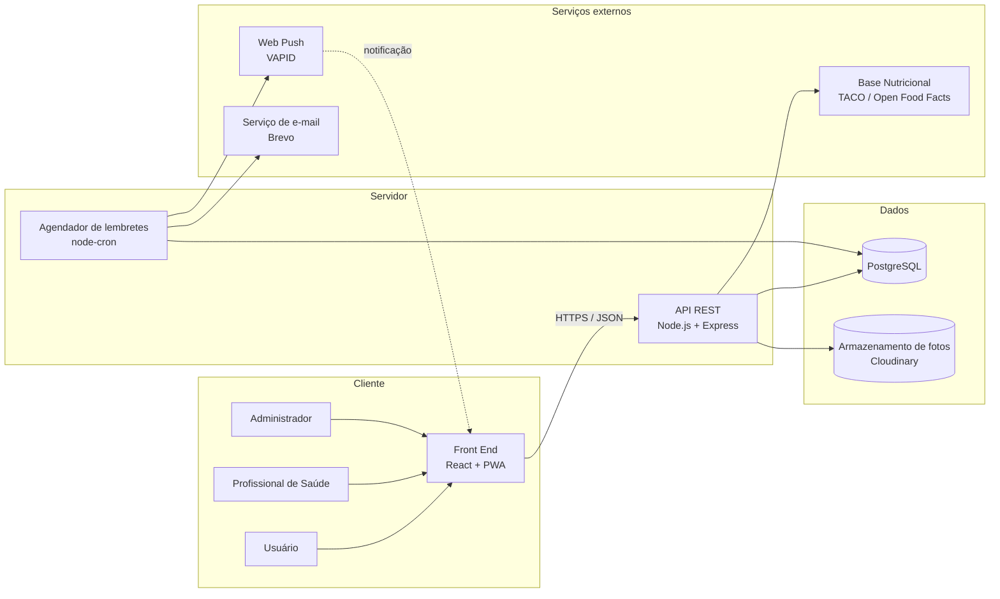
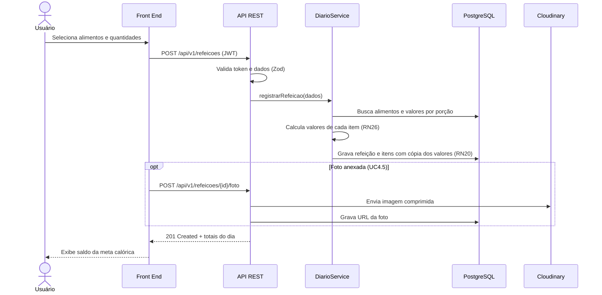
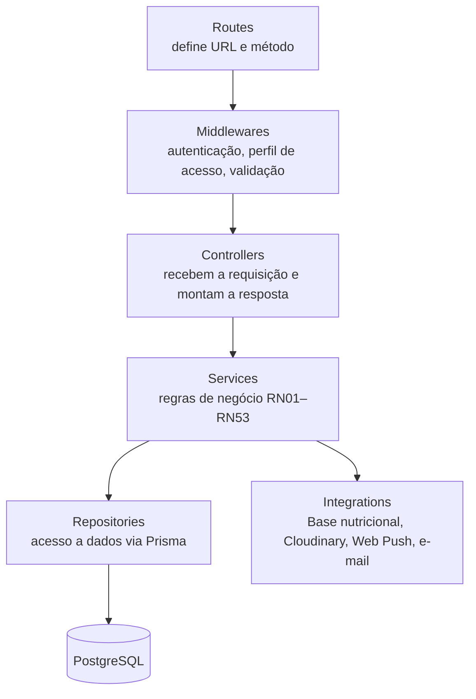
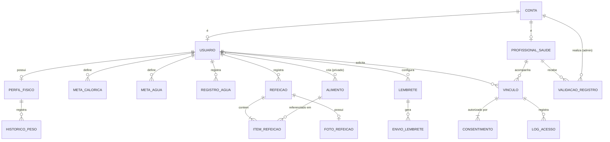
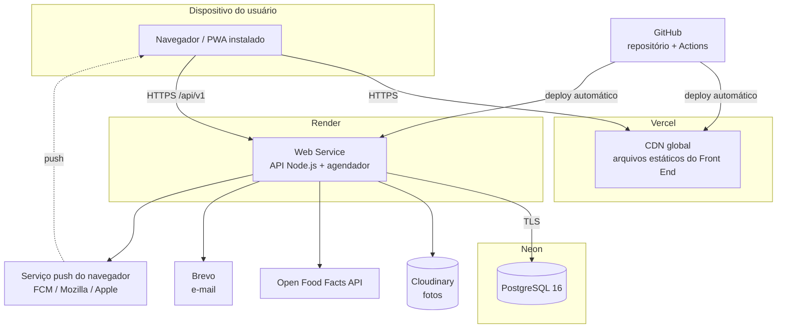

# 🏛️ Documento de Arquitetura do Sistema

## 1. Visão Geral do Sistema

O **NutriCount** é um sistema web responsivo (computador e celular) para controle de calorias, nutrientes e hidratação. O usuário registra refeições, com foto opcional, e o consumo de água. O sistema calcula automaticamente calorias e macronutrientes, compara o consumo com as metas pessoais e envia lembretes nos horários das refeições. O usuário também pode se vincular a um profissional de saúde, que acompanha os resultados dele dentro da plataforma.

Este documento descreve como o sistema é organizado tecnicamente: componentes, tecnologias, comunicação entre as partes, armazenamento de dados, segurança e implantação. Ele é a ponte entre os artefatos de análise (Documento de Visão, Diagrama e Especificação de Caso de Uso, Diagrama de Classes) e a implementação.

### 1.1 Principais requisitos que orientam a arquitetura

| Requisito | Origem | Impacto na arquitetura |
|---|---|---|
| Acesso pelo navegador, com interface responsiva | Escopo não funcional | Aplicação web SPA instalável como PWA |
| Busca de alimento em menos de 2 segundos | Desempenho | Índice de busca textual no banco e cache de alimentos recentes |
| Registrar refeição ou copo de água em menos de 1 minuto | Usabilidade | Atalhos, alimentos recentes e cálculo feito no back end |
| Dados de saúde tratados conforme a LGPD | Segurança | Consentimento registrado, controle de acesso por vínculo e log de acessos |
| Fotos com limite de tamanho e formato | Armazenamento | Upload validado e armazenamento em serviço de objetos |
| Lembretes por push ou e-mail, com permissão | Notificações | Agendador no back end + Web Push + serviço de e-mail |
| Base nutricional pública e sem custo | Restrição | Integração com tabela TACO (importada) e Open Food Facts (API) |
| 99% de disponibilidade mensal | Disponibilidade | Hospedagem gerenciada em nuvem, com monitoramento |
| Equipe de duas pessoas e prazo curto | Restrição | Stack única em TypeScript e serviços gerenciados de plano gratuito |

---

## 2. Arquitetura Geral da Solução

O NutriCount usa uma **arquitetura cliente-servidor em três camadas**:

1. **Camada de apresentação (Front End):** aplicação web SPA que roda no navegador.
2. **Camada de aplicação (Back End):** API REST que concentra as regras de negócio.
3. **Camada de dados:** banco de dados relacional e armazenamento de fotos.

O back end segue uma **arquitetura em camadas** (controller → service → repository), dentro de um **monólito modular**: uma única aplicação, separada internamente em módulos que correspondem aos casos de uso agrupadores (UC1 a UC10). Para uma equipe pequena, essa escolha é mais simples de desenvolver, testar e implantar do que microsserviços.



### 2.1 Módulos do sistema

| Módulo | Casos de uso | Responsabilidade |
|---|---|---|
| `auth` e `usuarios` | UC1 | Cadastro, autenticação, recuperação de senha e desativação de contas |
| `perfil` | UC2 | Dados físicos, cálculo de TMB/GET e metas calóricas |
| `alimentos` | UC3 | Catálogo, busca e importação da base externa |
| `diario` | UC4 | Refeições, itens e fotos |
| `relatorios` | UC5 | Resumo diário, histórico e comparação com a meta |
| `hidratacao` | UC6 | Meta de água, registros e evolução |
| `lembretes` | UC7 | Horários, agendamento e envio de lembretes |
| `profissionais` | UC8 | Cadastro e validação de profissionais |
| `vinculos` | UC9 | Solicitação, consentimento, aceite e encerramento |
| `acompanhamento` | UC10 | Painel de clientes, diário e evolução do cliente |

### 2.2 Fluxo de uma requisição (exemplo: Registrar Refeição, UC4.1)



---

## 3. Front End

### 3.1 Tecnologias

| Item | Tecnologia | Justificativa |
|---|---|---|
| Linguagem | TypeScript | Tipagem compartilhada com o back end e menos erros em tempo de execução |
| Biblioteca de interface | React 18 | Ampla documentação e ecossistema; componentização |
| Build e servidor de desenvolvimento | Vite | Build rápido e configuração mínima |
| Estilo | Tailwind CSS | Layout responsivo (mobile first) com pouco CSS próprio |
| Roteamento | React Router | Navegação entre telas sem recarregar a página |
| Comunicação com a API | Axios + TanStack Query | Cache de respostas, recarga automática e controle de carregamento |
| Formulários e validação | React Hook Form + Zod | Validação no cliente com os mesmos esquemas do back end |
| Gráficos | Recharts | Gráficos de consumo, hidratação e evolução de peso |
| PWA | vite-plugin-pwa (Service Worker) | Instalação no celular e recebimento de notificações push |

### 3.2 Organização do código

```
frontend/
├── src/
│   ├── api/            # cliente HTTP e chamadas por módulo
│   ├── components/     # componentes reutilizáveis (botões, cards, gráficos)
│   ├── features/       # telas por módulo: diario, hidratacao, perfil...
│   ├── hooks/          # hooks de dados (useDiario, useMetas...)
│   ├── routes/         # rotas públicas, do usuário, do profissional e do admin
│   ├── schemas/        # esquemas Zod de validação
│   ├── store/          # sessão do usuário (token e perfil de acesso)
│   └── sw.ts           # service worker (push e cache)
└── vite.config.ts
```

### 3.3 Áreas da aplicação

| Área | Perfil de acesso | Principais telas |
|---|---|---|
| Pública | Visitante | Login, cadastro de usuário, cadastro de profissional, recuperação de senha |
| Usuário | `USUARIO` | Diário do dia, registrar refeição, hidratação, relatórios, perfil e metas, lembretes, meus profissionais |
| Profissional | `PROFISSIONAL` | Solicitações, lista de clientes, diário e evolução do cliente, perfil profissional |
| Administração | `ADMIN` | Usuários, catálogo de alimentos, importação, validação de profissionais |

### 3.4 Decisões de usabilidade

- Botão flutuante de **"+ Refeição"** e **"+ Água"** na tela inicial, com atalhos de 200 ml e 500 ml, para cumprir a meta de registro em menos de 1 minuto.
- Lista de **alimentos recentes** antes da digitação na busca (UC3.3 – FA02).
- Busca com espera de 300 ms após a digitação (*debounce*) para não sobrecarregar a API.
- A foto da refeição é sempre opcional e comprimida no navegador antes do envio.
- O profissional chega ao diário de um cliente em até 3 cliques: **Meus clientes → Cliente → Diário**.

---

## 4. Back End

### 4.1 Tecnologias

| Item | Tecnologia | Justificativa |
|---|---|---|
| Plataforma | Node.js 20 LTS | Mesma linguagem do front end; boa performance para APIs de E/S |
| Linguagem | TypeScript | Tipagem e manutenção mais segura |
| Framework HTTP | Express | Simples, maduro e muito documentado |
| ORM | Prisma | Mapeamento das classes para tabelas, migrações versionadas e consultas tipadas |
| Validação | Zod | Validação de entrada de cada endpoint |
| Autenticação | JSON Web Token (jsonwebtoken) + bcrypt | Sessão sem estado e senha protegida com *hash* |
| Agendamento | node-cron | Verificação de lembretes pendentes a cada minuto |
| Notificações | web-push (VAPID) e Brevo (SMTP/API) | Push no navegador e e-mail, ambos com plano gratuito |
| Upload de fotos | Multer + Cloudinary SDK | Recebimento, validação e envio para armazenamento externo |
| Documentação da API | Swagger (OpenAPI 3) | Documentação navegável dos endpoints |
| Testes | Vitest + Supertest | Testes unitários das regras e testes dos endpoints |

### 4.2 Camadas



| Camada | Responsabilidade | Exemplo |
|---|---|---|
| Routes | Associa URL e método HTTP ao controller | `POST /refeicoes` → `DiarioController.registrar` |
| Middlewares | Autenticação, verificação de perfil, validação, tratamento de erros | `autenticar`, `exigirPerfil('ADMIN')`, `validar(schema)` |
| Controllers | Traduzem HTTP para chamadas de serviço | Lê o corpo, chama o serviço, devolve `201` |
| Services | Regras de negócio | `PerfilService.calcularNecessidadeCalorica()` (RN14, RN15) |
| Repositories | Consultas e gravações no banco | `RefeicaoRepository.listarPorData()` |
| Integrations | Comunicação com serviços externos | `OpenFoodFactsClient.buscar(termo)` |

### 4.3 Organização do código

```
backend/
├── prisma/
│   ├── schema.prisma        # modelo de dados
│   ├── migrations/          # histórico de alterações do banco
│   └── seed.ts              # importação inicial da tabela TACO
├── src/
│   ├── modules/
│   │   ├── auth/            # controller, service, routes, schemas
│   │   ├── usuarios/
│   │   ├── perfil/
│   │   ├── alimentos/
│   │   ├── diario/
│   │   ├── relatorios/
│   │   ├── hidratacao/
│   │   ├── lembretes/
│   │   ├── profissionais/
│   │   ├── vinculos/
│   │   └── acompanhamento/
│   ├── integrations/        # base nutricional, cloudinary, push, e-mail
│   ├── jobs/                # agendador de lembretes e expiração de vínculos
│   ├── middlewares/
│   ├── shared/              # erros, utilitários, tipos
│   └── server.ts
└── tests/
```

### 4.4 Tarefas agendadas

| Tarefa | Frequência | Regra |
|---|---|---|
| Verificar lembretes pendentes | A cada minuto | Envia o 1º lembrete 10 min após o horário sem registro e reenvia a cada 30 min, até 3 vezes (Documento de Visão; RN38, RN39) |
| Expirar solicitações de vínculo | Diária | Solicitações sem resposta em 15 dias passam a `EXPIRADO` (RN46) |
| Reativar lembretes pausados | Diária | Lembretes com `pausadoAte` vencido voltam a `ativo` |
| Anonimizar contas inativas | Diária | Contas desativadas há mais de 90 dias têm os dados pessoais anonimizados (RN07) |

### 4.5 Integração com a base nutricional

| Fonte | Forma de uso | Observação |
|---|---|---|
| **TACO** (Tabela Brasileira de Composição de Alimentos – Unicamp) | Importada uma vez para o banco pelo script `seed.ts` | Alimentos brasileiros *in natura*; valores por 100 g |
| **Open Food Facts** | Consultada pela API pública quando o alimento não está no catálogo (UC3.5) | Produtos industrializados com código de barras; gratuita e aberta |

Os dados importados são convertidos para a porção de referência de 100 g ou 100 ml (RN23), e o código de origem é guardado para evitar duplicidade (RN24).

---

## 5. Segurança

### 5.1 Autenticação

- Senhas armazenadas apenas como *hash* **bcrypt** (custo 10). Nunca em texto puro.
- Login gera um **token de acesso JWT** com validade de 2 horas e um **token de renovação** (*refresh token*) com validade de 30 dias, guardado em cookie `HttpOnly`, `Secure` e `SameSite=Strict` (RN06).
- Bloqueio de 15 minutos após 5 tentativas de login malsucedidas (RN05).
- Links de recuperação de senha e de confirmação de e-mail com token aleatório de uso único e validade limitada (1 h e 24 h; RN04).

### 5.2 Autorização

O controle de acesso combina **perfil de acesso** e **propriedade do dado**:

| Regra | Como é aplicada |
|---|---|
| Cada rota exige um perfil (`USUARIO`, `PROFISSIONAL`, `ADMIN`) | Middleware `exigirPerfil` |
| O usuário só acessa os próprios dados | Toda consulta filtra por `usuario_id` do token |
| O profissional só acessa clientes com vínculo `ATIVO` | Middleware `exigirVinculoAtivo` antes das rotas de acompanhamento |
| O profissional só vê os dados autorizados no consentimento | `Consentimento.permite(tipoDado)` antes de montar a resposta (RN47) |
| Profissional sem validação não aparece na busca nem recebe vínculos | Filtro `status_validacao = 'VALIDADO'` (RN41) |

### 5.3 LGPD e privacidade

- **Consentimento explícito** registrado com escopo, versão do termo, data e IP (UC9.3).
- O usuário pode **revogar** o consentimento ou **encerrar o vínculo** a qualquer momento, e o acesso do profissional é cortado imediatamente (RN48, RN50).
- Todo acesso de um profissional aos dados de um cliente é gravado em `log_acesso`, e o usuário pode consultar esse histórico (RN51).
- **Exclusão lógica** de contas, com anonimização dos dados pessoais após 90 dias (RN07, RN08).
- Coleta mínima: o sistema pede apenas os dados necessários para o cálculo nutricional.

### 5.4 Proteção da aplicação

| Ameaça | Medida |
|---|---|
| Interceptação de dados | HTTPS obrigatório em todos os ambientes (TLS fornecido pela hospedagem) |
| Injeção de SQL | Consultas parametrizadas pelo Prisma; nenhuma concatenação de SQL |
| XSS | Escape automático do React e cabeçalhos de segurança via `helmet` |
| CSRF | Cookie `SameSite=Strict` e token de acesso no cabeçalho `Authorization` |
| Força bruta e abuso da API | Limite de requisições com `express-rate-limit` (ex.: 10 logins/min por IP) |
| Upload malicioso | Validação de tipo MIME e extensão (JPG, PNG, HEIC), limite de 10 MB (RN29) e armazenamento fora do servidor |
| Vazamento de segredos | Chaves e senhas apenas em variáveis de ambiente; arquivo `.env` fora do repositório |
| Acesso indevido a fotos | URLs assinadas e com expiração para fotos de refeição |

---

## 6. Banco de Dados

### 6.1 Tecnologia

**PostgreSQL 16**, hospedado no **Neon** (plano gratuito). O modelo relacional é adequado porque os dados são estruturados e muito relacionados (usuário, refeições, itens, alimentos, vínculos), e as relações exigem integridade referencial. O esquema é criado e versionado pelas **migrações do Prisma**.

### 6.2 Modelo de dados

O modelo é derivado do Diagrama de Classes. A herança `Conta → Usuario / ProfissionalSaude / Administrador` foi mapeada com a estratégia **tabela por subclasse**: a tabela `conta` guarda os dados comuns e as tabelas `usuario` e `profissional_saude` guardam os específicos, com a mesma chave primária.



### 6.3 Principais tabelas

| Tabela | Campos principais | Observações |
|---|---|---|
| `conta` | id, nome, email, senha_hash, perfil, status, tentativas_login, data_criacao | `email` único; `perfil` ∈ {USUARIO, PROFISSIONAL, ADMIN} |
| `usuario` | conta_id (PK/FK), data_nascimento, sexo, notificacoes_permitidas | |
| `profissional_saude` | conta_id (PK/FK), cpf, profissao, conselho, numero_registro, uf, especialidades, descricao, codigo_convite, status_validacao | Únicos: `cpf` e (`conselho`, `numero_registro`, `uf`) (RN40) |
| `perfil_fisico` | usuario_id (PK/FK), peso, altura, nivel_atividade, objetivo, data_atualizacao | `CHECK` peso 30–300 e altura 100–250 (RN09) |
| `historico_peso` | id, usuario_id, data, peso | |
| `meta_calorica` | id, usuario_id, valor_kcal, origem, perc_proteinas, perc_carboidratos, perc_gorduras, data_inicio, data_fim | `CHECK` 1.200–5.000 kcal (RN11); `data_fim` nula = vigente (RN13) |
| `meta_agua` | id, usuario_id, valor_ml, origem, data_inicio, data_fim | `CHECK` 1.000–6.000 ml (RN35) |
| `registro_agua` | id, usuario_id, data_hora, quantidade_ml | `CHECK` 1–2.000 ml (RN36) |
| `alimento` | id, nome, marca, categoria, porcao_referencia, unidade, calorias, proteinas, carboidratos, gorduras, fibras, sodio, origem, codigo_externo, visibilidade, criado_por, status | `codigo_externo` único (RN24) |
| `refeicao` | id, usuario_id, data, horario, tipo, observacao | |
| `item_refeicao` | id, refeicao_id, alimento_id, quantidade, unidade, calorias, proteinas, carboidratos, gorduras | Cópia dos valores no momento do registro (RN20) |
| `foto_refeicao` | refeicao_id (PK/FK), url, formato, tamanho_bytes, data_envio | Exclusão em cascata com a refeição (RN28) |
| `lembrete` | id, usuario_id, tipo, tipo_refeicao, horario, dias_semana, ativo, pausado_ate, fuso_horario | |
| `envio_lembrete` | id, lembrete_id, data_hora, tentativa, canal, situacao | |
| `inscricao_push` | id, usuario_id, endpoint, chave_p256dh, chave_auth | Uma por navegador ou aparelho |
| `vinculo` | id, usuario_id, profissional_id, status, mensagem, data_solicitacao, data_inicio, data_fim, motivo_encerramento | Índice único parcial: um vínculo ativo ou pendente por par usuário–profissional (RN45) |
| `consentimento` | id, vinculo_id, compartilha_diario, compartilha_fotos, compartilha_hidratacao, compartilha_peso, versao_termo, data_hora, ip, revogado_em | |
| `log_acesso` | id, vinculo_id, dado_acessado, data_hora | Somente inserção, sem alteração |
| `validacao_registro` | id, profissional_id, admin_id, decisao, motivo, documento, data | |

### 6.4 Índices para desempenho

| Índice | Finalidade |
|---|---|
| `alimento` — índice GIN com `pg_trgm` e `unaccent` sobre `nome` | Busca por parte do nome, sem acento, em menos de 2 s (RN21) |
| `refeicao (usuario_id, data)` | Diário do dia e relatórios por período |
| `registro_agua (usuario_id, data_hora)` | Total diário e evolução da hidratação |
| `vinculo (profissional_id, status)` | Lista de clientes do profissional |
| `lembrete (ativo, horario)` | Consulta do agendador a cada minuto |

---

## 7. Endpoints

API REST com JSON, prefixo `/api/v1`. Todas as rotas, exceto as marcadas como **Pública**, exigem o cabeçalho `Authorization: Bearer <token>`. A documentação completa fica disponível em `/api/docs` (Swagger).

### 7.1 Autenticação e usuários (UC1)

| Método | Rota | Acesso | Descrição | UC |
|---|---|---|---|---|
| POST | `/auth/cadastro` | Pública | Cria conta de usuário | UC1.1 |
| POST | `/auth/login` | Pública | Autentica e devolve os tokens | UC1.3 |
| POST | `/auth/renovar` | Pública (cookie) | Gera novo token de acesso | UC1.3 |
| POST | `/auth/logout` | Autenticado | Encerra a sessão | UC1.3 |
| POST | `/auth/recuperar-senha` | Pública | Envia link de redefinição | UC1.3 FA01 |
| POST | `/auth/redefinir-senha` | Pública (token) | Define nova senha | UC1.3 FA01 |
| GET | `/usuarios/me` | Usuário | Consulta os dados da conta | UC1.2 |
| PATCH | `/usuarios/me` | Usuário | Altera dados da conta | UC1.2 |
| PATCH | `/usuarios/me/senha` | Usuário | Altera a senha | UC1.2 FA01 |
| DELETE | `/usuarios/me` | Usuário | Desativa a própria conta | UC1.4 |
| GET | `/admin/usuarios` | Admin | Lista e pesquisa usuários | UC1 |
| POST | `/admin/usuarios` | Admin | Inclui usuário com senha provisória | UC1.1 FA01 |
| PATCH | `/admin/usuarios/{id}` | Admin | Altera usuário | UC1.2 FA03 |
| PATCH | `/admin/usuarios/{id}/status` | Admin | Desativa ou reativa usuário | UC1.4 FA01 |

### 7.2 Perfil e metas (UC2)

| Método | Rota | Acesso | Descrição | UC |
|---|---|---|---|---|
| GET | `/perfil` | Usuário | Consulta perfil, IMC, TMB, GET e meta vigente | UC2.4 |
| PUT | `/perfil` | Usuário | Cria ou altera o perfil físico | UC2.1 |
| GET | `/perfil/historico-peso` | Usuário | Evolução do peso | UC2.4 FA01 |
| GET | `/perfil/necessidade-calorica` | Usuário | Calcula a necessidade calórica | UC2.3 |
| GET | `/metas/caloricas/vigente` | Usuário | Consulta a meta calórica atual | UC2.2 |
| POST | `/metas/caloricas` | Usuário | Define nova meta (calculada ou personalizada) | UC2.2 |

### 7.3 Catálogo de alimentos (UC3)

| Método | Rota | Acesso | Descrição | UC |
|---|---|---|---|---|
| GET | `/alimentos?busca=&categoria=&pagina=` | Autenticado | Pesquisa alimentos | UC3.3 |
| GET | `/alimentos/recentes` | Usuário | Alimentos usados recentemente | UC3.3 FA02 |
| GET | `/alimentos/{id}` | Autenticado | Detalhes nutricionais | UC3.3 |
| POST | `/alimentos` | Admin / Usuário | Inclui alimento (público ou privado) | UC3.1 |
| PATCH | `/alimentos/{id}` | Admin / dono | Altera alimento | UC3.2 |
| PATCH | `/alimentos/{id}/status` | Admin / dono | Desativa ou reativa alimento | UC3.4 |
| GET | `/alimentos/externos?busca=` | Autenticado | Busca na base nutricional externa | UC3.5 |
| POST | `/alimentos/importar` | Admin / Usuário | Importa alimentos da base externa | UC3.5 |

### 7.4 Diário alimentar (UC4)

| Método | Rota | Acesso | Descrição | UC |
|---|---|---|---|---|
| GET | `/refeicoes?data=AAAA-MM-DD` | Usuário | Refeições e totais do dia | UC4.4 |
| GET | `/refeicoes/{id}` | Usuário | Detalhes de uma refeição | UC4.4 FA02 |
| POST | `/refeicoes` | Usuário | Registra refeição com itens | UC4.1 |
| POST | `/refeicoes/{id}/repetir` | Usuário | Copia refeição para outra data | UC4.1 FA03 |
| PUT | `/refeicoes/{id}` | Usuário | Altera refeição | UC4.2 |
| DELETE | `/refeicoes/{id}` | Usuário | Exclui refeição | UC4.3 |
| POST | `/refeicoes/{id}/foto` | Usuário | Anexa foto (multipart/form-data) | UC4.5 |
| DELETE | `/refeicoes/{id}/foto` | Usuário | Remove a foto | UC4.2 FA03 |

### 7.5 Relatórios (UC5)

| Método | Rota | Acesso | Descrição | UC |
|---|---|---|---|---|
| GET | `/relatorios/resumo-diario?data=` | Usuário | Calorias, macronutrientes e água do dia | UC5.1 |
| GET | `/relatorios/historico?inicio=&fim=` | Usuário | Consumo por dia e médias do período | UC5.2 |
| GET | `/relatorios/comparativo-meta?inicio=&fim=` | Usuário | Consumo × meta e classificação dos dias | UC5.3 |
| GET | `/relatorios/exportar?inicio=&fim=&formato=pdf` | Usuário | Exporta relatório em PDF ou CSV | UC5.2 FA02 |

### 7.6 Hidratação (UC6)

| Método | Rota | Acesso | Descrição | UC |
|---|---|---|---|---|
| GET | `/hidratacao/meta` | Usuário | Meta de água vigente e sugestão | UC6.1 |
| POST | `/hidratacao/meta` | Usuário | Define meta de água | UC6.1 |
| GET | `/hidratacao/registros?data=` | Usuário | Registros e total do dia | UC6.2 |
| POST | `/hidratacao/registros` | Usuário | Registra consumo de água | UC6.2 |
| PATCH | `/hidratacao/registros/{id}` | Usuário | Altera registro | UC6.3 |
| DELETE | `/hidratacao/registros/{id}` | Usuário | Remove registro | UC6.3 FA01 |
| GET | `/hidratacao/evolucao?inicio=&fim=` | Usuário | Dias com e sem meta atingida | UC6.4 |

### 7.7 Lembretes (UC7)

| Método | Rota | Acesso | Descrição | UC |
|---|---|---|---|---|
| GET | `/lembretes` | Usuário | Lista lembretes configurados | UC7.2 |
| POST | `/lembretes` | Usuário | Define horários de refeições | UC7.1 |
| PATCH | `/lembretes/{id}` | Usuário | Altera, ativa ou desativa lembrete | UC7.2 |
| POST | `/lembretes/pausar` | Usuário | Pausa todos os lembretes até uma data | UC7.2 FA02 |
| POST | `/notificacoes/inscricao` | Usuário | Registra a inscrição push do navegador | UC7.1 FA02 |
| DELETE | `/notificacoes/inscricao` | Usuário | Remove a inscrição push | UC7.2 |

O envio do lembrete (UC7.3) não tem endpoint: é feito pela tarefa agendada do back end.

### 7.8 Profissionais (UC8)

| Método | Rota | Acesso | Descrição | UC |
|---|---|---|---|---|
| POST | `/profissionais/cadastro` | Pública | Cadastro do profissional | UC8.1 |
| GET | `/profissionais/me` | Profissional | Consulta o próprio perfil | UC8.2 |
| PATCH | `/profissionais/me` | Profissional | Altera o próprio perfil | UC8.2 |
| DELETE | `/profissionais/me` | Profissional | Desativa o próprio cadastro | UC8.4 FA01 |
| GET | `/admin/profissionais?status=PENDENTE` | Admin | Lista cadastros pendentes de validação | UC8.3 |
| POST | `/admin/profissionais/{id}/validacao` | Admin | Aprova ou rejeita o registro | UC8.3 |
| PATCH | `/admin/profissionais/{id}/status` | Admin | Desativa profissional | UC8.4 |

### 7.9 Vínculos (UC9)

| Método | Rota | Acesso | Descrição | UC |
|---|---|---|---|---|
| GET | `/profissionais?busca=&profissao=&uf=` | Usuário | Busca profissionais validados | UC9.1 |
| GET | `/profissionais/convite/{codigo}` | Usuário | Busca por código de convite | UC9.1 FA01 |
| GET | `/vinculos` | Usuário / Profissional | Lista vínculos e solicitações | UC9 |
| POST | `/vinculos` | Usuário | Solicita vínculo com consentimento | UC9.2, UC9.3 |
| PATCH | `/vinculos/{id}/consentimento` | Usuário | Altera ou revoga o escopo autorizado | UC9.3 FA02 |
| POST | `/vinculos/{id}/aceitar` | Profissional | Aceita a solicitação | UC9.4 |
| POST | `/vinculos/{id}/recusar` | Profissional | Recusa a solicitação | UC9.4 FA01 |
| POST | `/vinculos/{id}/cancelar` | Usuário | Cancela solicitação pendente | UC9.2 FA01 |
| POST | `/vinculos/{id}/encerrar` | Usuário / Profissional | Encerra vínculo ativo | UC9.5 |
| GET | `/vinculos/{id}/acessos` | Usuário | Histórico de acessos do profissional | RN51 |

### 7.10 Acompanhamento de clientes (UC10)

| Método | Rota | Acesso | Descrição | UC |
|---|---|---|---|---|
| GET | `/clientes` | Profissional | Lista clientes vinculados com adesão à meta | UC10.1 |
| GET | `/clientes/{id}/diario?data=` | Profissional (vínculo ativo) | Diário do cliente, somente leitura | UC10.2 |
| GET | `/clientes/{id}/evolucao?inicio=&fim=` | Profissional (vínculo ativo) | Consumo, meta, hidratação e peso | UC10.3 |
| GET | `/clientes/{id}/evolucao/exportar` | Profissional (vínculo ativo) | Exporta relatório em PDF | UC10.3 FA02 |

### 7.11 Padrão de respostas

| Código | Uso |
|---|---|
| `200 OK` | Consulta ou alteração bem-sucedida |
| `201 Created` | Recurso criado |
| `204 No Content` | Exclusão bem-sucedida |
| `400 Bad Request` | Dados inválidos (detalhes por campo no corpo) |
| `401 Unauthorized` | Token ausente, inválido ou expirado |
| `403 Forbidden` | Perfil sem permissão ou vínculo inativo |
| `404 Not Found` | Recurso inexistente ou de outro usuário |
| `409 Conflict` | Duplicidade (e-mail, registro profissional, vínculo existente) |
| `422 Unprocessable Entity` | Violação de regra de negócio (ex.: prazo de 7 dias expirado) |
| `429 Too Many Requests` | Limite de requisições excedido |
| `502 Bad Gateway` | Falha em serviço externo (base nutricional) |

Exemplo de erro:

```json
{
  "erro": "REGRA_NEGOCIO",
  "mensagem": "Refeições só podem ser alteradas em até 7 dias.",
  "regra": "RN27"
}
```

---

## 8. Arquitetura de Implantação

Todos os serviços usam planos gratuitos, conforme a restrição de custo do briefing.



| Componente | Serviço | Função |
|---|---|---|
| Front End | Vercel | Hospeda os arquivos estáticos em CDN, com HTTPS automático |
| Back End | Render (Web Service) | Executa a API e as tarefas agendadas |
| Banco de dados | Neon (PostgreSQL) | Banco gerenciado, com backup automático |
| Fotos | Cloudinary | Armazenamento, compressão e entrega das imagens |
| E-mail | Brevo | Lembretes por e-mail, recuperação de senha e avisos |
| Push | Web Push (VAPID) | Entrega de notificações pelo serviço do próprio navegador |
| Código e CI/CD | GitHub + GitHub Actions | Versionamento, testes automáticos e implantação |

### 8.1 Ambientes

| Ambiente | Finalidade | Banco |
|---|---|---|
| Desenvolvimento | Máquina dos integrantes | PostgreSQL local via Docker Compose |
| Homologação | Testes antes da entrega | Branch de banco no Neon |
| Produção | Uso pelos usuários de teste e avaliação | Banco principal no Neon |

### 8.2 Integração e entrega contínuas

1. O integrante envia o código para uma branch e abre um *pull request*.
2. O GitHub Actions executa *lint*, testes e build.
3. Após a revisão do outro integrante, o código entra na branch `main`.
4. A Vercel e o Render implantam automaticamente a nova versão.
5. As migrações do banco (`prisma migrate deploy`) rodam antes de a API subir.

### 8.3 Disponibilidade e monitoramento

- **Monitor de disponibilidade** (UptimeRobot) consultando `GET /api/v1/health` a cada 5 minutos, para acompanhar a meta de 99%.
- **Registro de erros** com logs estruturados no Render.
- **Backup** diário automático do banco, com restauração para um ponto no tempo nos últimos 7 dias.

---

## 9. Benefícios da Arquitetura

| Benefício | Como a arquitetura o garante |
|---|---|
| **Simplicidade para uma dupla** | Uma única linguagem (TypeScript) no front e no back end, monólito modular e serviços gerenciados, sem servidores para administrar |
| **Custo zero** | Todas as tecnologias são livres e os serviços de hospedagem têm planos gratuitos suficientes para o projeto |
| **Organização por casos de uso** | Cada módulo do back end corresponde a um caso de uso agrupador, o que facilita a rastreabilidade entre a especificação e o código |
| **Manutenção e evolução** | Separação em camadas permite alterar regras de negócio sem mexer em rotas ou no banco; os módulos podem virar serviços separados no futuro |
| **Desempenho** | Índices de busca textual, cache no front end e CDN atendem ao limite de 2 segundos |
| **Uso no celular** | PWA responsivo, instalável na tela inicial e com notificações push, sem precisar publicar em lojas de aplicativos |
| **Privacidade** | Consentimento, controle de acesso por vínculo, log de acessos e exclusão lógica atendem à LGPD |
| **Confiabilidade dos dados** | Integridade referencial e restrições `CHECK` no banco, mais validação no front e no back end |
| **Qualidade contínua** | Testes automatizados e implantação automática a cada alteração aprovada |

---

## 10. Considerações e orientações técnicas

### 10.1 Padrões de desenvolvimento

- **Versionamento:** Git com GitHub Flow (branch por funcionalidade + *pull request*). Mensagens de commit no padrão Conventional Commits (`feat:`, `fix:`, `docs:`).
- **Padronização de código:** ESLint e Prettier nos dois projetos, verificados no CI.
- **Nomenclatura:** código e banco em português, conforme o Diagrama de Classes (`Refeicao`, `item_refeicao`), para manter a rastreabilidade com os artefatos.
- **Variáveis de ambiente:** arquivo `.env.example` versionado com todas as chaves necessárias, sem valores reais.

### 10.2 Testes

| Tipo | Ferramenta | Foco |
|---|---|---|
| Unitário | Vitest | Cálculos e regras: TMB/GET (RN14, RN15), valores do item (RN26), classificação da meta (RN33), meta de água (RN34) |
| Integração | Vitest + Supertest | Endpoints com banco de testes, incluindo permissões por perfil e por vínculo |
| Interface | Testing Library | Formulários de registro de refeição e de água |
| Manual | Roteiros a partir da Especificação de Caso de Uso | Fluxos principal, alternativos e de exceção |

### 10.3 Datas e fusos horários

- Datas e horários gravados em **UTC** no banco.
- O fuso horário do usuário (ex.: `America/Sao_Paulo`) é guardado no lembrete e usado para o envio no horário local (RN39).
- O "dia" do diário e dos relatórios é calculado no fuso do usuário, para que uma refeição às 23h não caia no dia seguinte.

### 10.4 Riscos técnicos e mitigação

| Risco | Mitigação |
|---|---|
| Base nutricional externa fora do ar | Catálogo local com a tabela TACO; a base externa é usada só como complemento |
| Hibernação do servidor no plano gratuito do Render (após inatividade) | Monitor de disponibilidade mantém o serviço ativo; em produção real, migrar para plano pago |
| Navegador sem suporte a push (ex.: iOS sem PWA instalado) | Envio alternativo por e-mail, conforme a preferência do usuário |
| Limites dos planos gratuitos | Compressão de fotos no navegador e no Cloudinary; volume de dados pequeno no período de testes |
| Prazo curto da dupla | Priorizar UC1, UC2, UC3, UC4 e UC6 (núcleo do sistema), depois UC5 e UC7 e, por último, UC8 a UC10 |

### 10.5 Evoluções futuras

- Aplicativo nativo com React Native, reaproveitando a mesma API.
- Leitura de código de barras para registrar alimentos industrializados.
- Reconhecimento de alimentos pela foto da refeição.
- Chat entre usuário e profissional dentro do vínculo.
- Separação do módulo de notificações em um serviço próprio, com fila de mensagens, se o volume de lembretes crescer.


