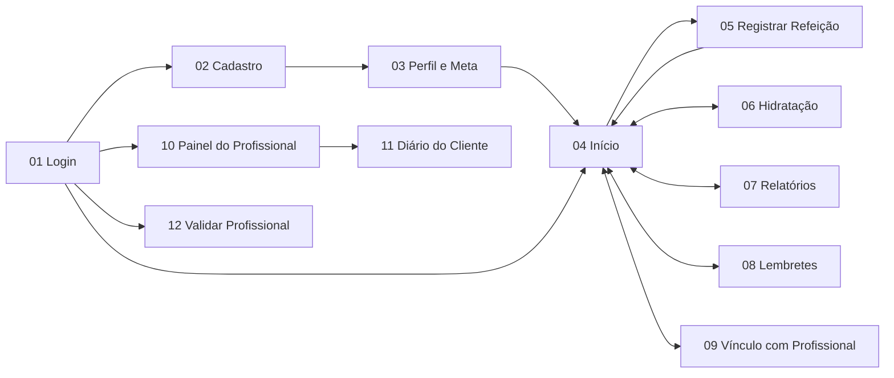

# 🎨 Protótipo do Sistema

## 1. Introdução

O protótipo do NutriCount é uma representação navegável da interface do sistema, feita antes da implementação. Ele mostra como o usuário, o profissional de saúde e o administrador vão interagir com as funcionalidades descritas no Documento de Visão e na Especificação de Caso de Uso.

O protótipo tem três objetivos:

- **Validar a interface com os usuários:** permite testar com pessoas reais se as telas são claras e se as tarefas principais são fáceis de executar, antes de investir tempo em programação.
- **Comprovar os critérios de usabilidade:** o Documento de Visão exige registrar uma refeição ou um copo de água em menos de 1 minuto e que o profissional acesse os resultados de um cliente em até 3 cliques. O protótipo permite cronometrar essas tarefas.
- **Servir de referência para o desenvolvimento:** define o layout, a hierarquia das informações, as cores, os componentes e o fluxo de navegação que o Front End vai implementar.

O protótipo é de **alta fidelidade** e foi desenhado para celular (390 × 844 px), já que o registro de refeições e de água acontece ao longo do dia, fora do computador. Todas as telas são clicáveis e algumas têm interações funcionais, como a escolha do objetivo, o ajuste de quantidade do alimento, o registro de água e o aceite de vínculo.

### 1.1 Decisões visuais

| Elemento | Decisão |
|---|---|
| Cor principal | Verde (`#166534`), ligado a saúde e alimentação; usado nas ações principais |
| Cor da hidratação | Azul (`#1D4ED8`), para diferenciar água de calorias |
| Cor do profissional | Roxo (`#5B21B6`), para distinguir a área do profissional da área do usuário |
| Tipografia | Space Grotesk nos títulos e números; Inter nos textos |
| Navegação | Barra inferior com 5 abas: Início, Água, Relatórios, Lembretes e Profissional |
| Acessibilidade | Contraste mínimo de 4,5:1, botões com no mínimo 44 px de altura e campos com rótulo |

---

## 2. Ferramentas Utilizadas

| Ferramenta | Uso |
|---|---|
| **Claude Design** (canvas de design do Claude) | Criação das 12 telas, organização no canvas e modo de apresentação navegável (Play) |
| **HTML e CSS** | Estrutura e estilo de cada tela, o que deixa o protótipo próximo do resultado final em React + Tailwind |
| **Google Fonts** | Fontes Inter e Space Grotesk |

---

## 3. Telas do Sistema

| Nº | Tela | Ator | Casos de uso | O que a tela mostra |
|---|---|---|---|---|
| 01 | Login | Todos | UC1.3 | E-mail, senha, recuperação de senha e acesso às áreas do profissional e do administrador |
| 02 | Cadastro | Usuário | UC1.1 | Nome, e-mail, nascimento, sexo, senha e aceite dos Termos de Uso |
| 03 | Perfil e Meta Calórica | Usuário | UC2.1, UC2.2, UC2.3 | Peso, altura, nível de atividade, objetivo e meta calculada (IMC, TMB e GET) |
| 04 | Início / Diário Alimentar | Usuário | UC4.4, UC5.1, UC5.3 | Calorias restantes, macronutrientes, resumo da água e refeições do dia |
| 05 | Registrar Refeição | Usuário | UC4.1, UC3.3, UC4.5 | Tipo de refeição, busca de alimento, quantidade, itens da refeição e foto opcional |
| 06 | Controle de Hidratação | Usuário | UC6.2, UC6.4 | Total do dia, atalhos de 200 ml e 500 ml, evolução dos últimos 7 dias e registros |
| 07 | Relatórios de Consumo | Usuário | UC5.2, UC5.3 | Média diária, dias dentro da meta, gráfico calorias × meta e macronutrientes |
| 08 | Lembretes de Refeição | Usuário | UC7.1, UC7.2 | Horários de cada refeição, ativação, canal (push ou e-mail) e pausa |
| 09 | Vínculo com Profissional | Usuário | UC9.1, UC9.2, UC9.3, UC9.5 | Busca, perfil do profissional, consentimento de dados e vínculos ativos |
| 10 | Painel do Profissional | Profissional | UC10.1, UC9.4 | Indicadores, nova solicitação (aceitar ou recusar) e lista de clientes |
| 11 | Diário do Cliente | Profissional | UC10.2, UC10.3 | Diário do dia e evolução de 30 dias do cliente, em modo somente leitura |
| 12 | Validar Profissional | Administrador | UC8.3 | Dados do registro, documento, aprovação ou rejeição com motivo |

### 3.1 Fluxo de navegação

### 3.2 Interações funcionais do protótipo

| Tela | Interação | Regra demonstrada |
|---|---|---|
| 03 Perfil e Meta | Escolher o objetivo recalcula a meta (2.255, 2.755 ou 3.055 kcal) | RN14 e RN15 |
| 05 Registrar Refeição | Botões − e + mudam a quantidade e recalculam as calorias do item e o total | RN26 |
| 06 Hidratação | Botões +200 ml e +500 ml somam ao total e mostram quando a meta é atingida | UC6.2 |
| 08 Lembretes | Chaves liga/desliga ativam e desativam cada lembrete | UC7.2 FA01 |
| 09 Vínculo | "Solicitar acompanhamento" abre o consentimento, e "Autorizar" envia a solicitação | UC9.2, UC9.3 |
| 10 Painel do Profissional | "Aceitar" inclui o cliente na lista; "Recusar" remove a solicitação | UC9.4 |
| 11 Diário do Cliente | Abas Diário e Evolução | UC10.2, UC10.3 |
| 12 Validar Profissional | "Aprovar" ou "Rejeitar" atualiza o status do cadastro | UC8.3 |

### 3.3 Roteiro sugerido para o teste de usabilidade

1. Criar uma conta e definir o objetivo "Perder peso" (telas 01 → 02 → 03).
2. Registrar o jantar com arroz e feijão, ajustando a quantidade do arroz (tela 05). **Meta: menos de 1 minuto.**
3. Registrar um copo de água (tela 06). **Meta: menos de 1 minuto.**
4. Desativar o lembrete do jantar (tela 08).
5. Solicitar acompanhamento a uma nutricionista, sem compartilhar as fotos (tela 09).
6. Como profissional, aceitar a solicitação e abrir o diário de um cliente (telas 10 → 11). **Meta: até 3 cliques.**

---

## 4. Protótipo

**Protótipo navegável:** https://claude.ai/artifact/8aKxxF1XKPZoJUZzvDrUMB

Para navegar, abra o link e clique em **Play** em qualquer tela. A apresentação começa pela tela de Login, e os botões e links levam às outras telas.

<!-- Para incluir as imagens, exporte cada tela pelo menu do protótipo e adicione abaixo:

-->
