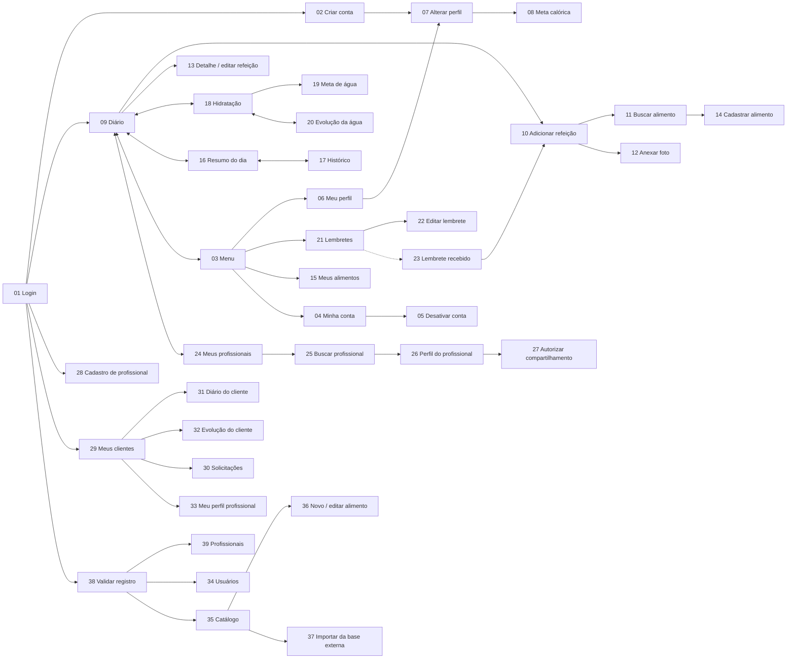

# 🎨 Protótipo do Sistema

## 1. Introdução

O protótipo do NutriCount é uma representação navegável da interface do sistema, feita antes da implementação. Ele mostra como o usuário, o profissional de saúde e o administrador vão interagir com **todos os casos de uso específicos** da Especificação de Caso de Uso (UC1.1 a UC10.3).

Esta versão substitui a anterior, que tinha 12 telas e não cobria vários casos de uso (por exemplo: alterar e excluir refeição, anexar foto, catálogo de alimentos, meta de água, alteração de conta, desativação, solicitações do profissional, gestão de usuários e de profissionais pelo administrador). Agora são **39 telas**, e cada uma indica no título os casos de uso e os fluxos (FP, FA, FE) que representa.

O protótipo tem três objetivos:

- **Validar a interface com os usuários:** permite testar com pessoas reais se as telas são claras e se as tarefas principais são fáceis de executar, antes da programação.
- **Comprovar os critérios de usabilidade:** o Documento de Visão exige registrar uma refeição ou um copo de água em menos de 1 minuto e que o profissional acesse os resultados de um cliente em até 3 cliques.
- **Servir de referência para o desenvolvimento:** define layout, componentes, textos e fluxo de navegação que o Front End vai implementar.

### 1.1 Alinhamento com a Especificação de Caso de Uso

Para o protótipo ficar de acordo com os casos de uso, foram seguidas estas regras:

- **Nomes de menus iguais aos da especificação:** “Criar conta”, “Minha conta”, “Meu perfil > Editar”, “Meta calórica”, “Diário”, “Adicionar refeição”, “Hidratação > Meta”, “Hidratação > Evolução”, “Relatórios > Resumo do dia / Histórico”, “Lembretes”, “Profissionais > Buscar”, “Meus profissionais”, “Solicitações”, “Meus clientes”, “Catálogo > Novo alimento”, “Catálogo > Importar da base externa”, “Profissionais > Pendentes de validação”, “Usuários”.
- **Fluxos alternativos e de exceção visíveis:** por exemplo, recuperar senha (UC1.3 FA01), credenciais inválidas (UC1.3 FE01), termos não aceitos (UC1.1 FE03), refeição sem itens (UC4.1 FE01), desfazer exclusão (UC4.3 FA01), arquivo de foto inválido (UC4.5 FE01), busca na base externa (UC3.3 FA03), meta atingida (UC6.2 FA02), conflito de horários (UC7.2 FE01), pausar lembretes (UC7.2 FA02), autorização negada (UC9.2 FE02), recusa de vínculo com motivo (UC9.4 FA01), rejeição e pedido de documento (UC8.3 FA01 e FA02).
- **Regras de negócio na tela:** limites e cálculos aparecem onde o usuário decide, como RN02 (senha), RN11 (faixa da meta), RN14 e RN15 (cálculo da meta), RN26 (calorias do item), RN27 (7 dias de retroatividade), RN33 (dentro da meta = ±10%), RN35 e RN36 (água), RN37 (30 min entre lembretes), RN45 (3 vínculos), RN47 (diário obrigatório no consentimento), RN49 (100 clientes), RN51 (log de acessos) e RN52 (profissional só lê).

### 1.2 Decisões visuais

| Elemento | Decisão |
|---|---|
| Cor principal | Verde (`#166534`), ligado a saúde e alimentação; usado nas ações do usuário |
| Cor da hidratação | Azul (`#1D4ED8`), para diferenciar água de calorias |
| Cor do profissional | Roxo (`#5B21B6`), para distinguir a área do profissional |
| Cor do administrador | Grafite (`#1F2937`), para a área administrativa |
| Formato | Usuário em celular (390 × 844 px), porque o registro acontece ao longo do dia; profissional e administrador em computador (1280 × 820 px), porque trabalham com listas e tabelas |
| Tipografia | Space Grotesk nos títulos e números; Inter nos textos |
| Navegação do usuário | Barra inferior com 5 abas: Diário, Água, Relatórios, Profissionais e Menu (Meu perfil, Meta calórica, Lembretes, Meus alimentos, Minha conta) |
| Navegação do profissional e do administrador | Menu lateral com as opções da especificação |
| Acessibilidade | Contraste mínimo de 4,5:1, botões com no mínimo 44 px de altura e campos com rótulo |

---

## 2. Ferramentas Utilizadas

| Ferramenta | Uso |
|---|---|
| **Claude Design** (canvas de design do Claude) | Criação das 39 telas, organização no canvas por ator e módulo e modo de apresentação navegável (Play) |
| **HTML e CSS** | Estrutura e estilo de cada tela, próximo do resultado final em React + Tailwind |
| **Google Fonts** | Fontes Inter e Space Grotesk |

---

## 3. Telas do Sistema

| Nº | Tela | Ator | Casos de uso (fluxos) |
|---|---|---|---|
| 01 | Login | Todos | UC1.3 (FP, FA01, FE01) |
| 02 | Criar conta | Usuário | UC1.1 (FP, FE01, FE03) |
| 03 | Menu | Usuário | Navegação (UC1, UC2, UC3, UC7) |
| 04 | Minha conta | Usuário | UC1.2 (FP, FA01, FA02), UC1.4 |
| 05 | Desativar conta | Usuário | UC1.4 (FP, FA02) |
| 06 | Meu perfil | Usuário | UC2.4 (FP, FA01), UC2.3 |
| 07 | Alterar perfil | Usuário | UC2.1 (FP, FA01), UC2.3 |
| 08 | Meta calórica | Usuário | UC2.2 (FP, FA01, FA02, FE01), UC2.3 |
| 09 | Diário (Início) | Usuário | UC4.4 (FP, FA01, FA02, FE01), UC5.1, UC5.3 |
| 10 | Adicionar refeição | Usuário | UC4.1 (FP, FA01–FA04, FE01, FE02), UC3.3, UC4.5 |
| 11 | Buscar alimento | Usuário | UC3.3 (FP, FA01–FA03, FE01), UC3.5 (FA01) |
| 12 | Anexar foto | Usuário | UC4.5 (FP, FA01, FE01, FE02) |
| 13 | Detalhe / editar refeição | Usuário | UC4.4 (FA02), UC4.2 (FP, FA01–FA03), UC4.3 (FP, FA01) |
| 14 | Cadastrar alimento (privado) | Usuário | UC3.1 (FA01, FE01, FE02) |
| 15 | Meus alimentos | Usuário | UC3.2 (FA01), UC3.4 (FA02), UC3.3 |
| 16 | Resumo do dia | Usuário | UC5.1 (FP, FA01), UC5.3 (FP, FA01) |
| 17 | Histórico de consumo | Usuário | UC5.2 (FP, FA01, FA02), UC5.3 |
| 18 | Hidratação | Usuário | UC6.2 (FP, FA01, FA02), UC6.3 (FP, FA01) |
| 19 | Meta de água | Usuário | UC6.1 (FP, FA01, FE02) |
| 20 | Evolução da hidratação | Usuário | UC6.4 (FP, FA01) |
| 21 | Lembretes | Usuário | UC7.1 (FP, FA01, FA02), UC7.2 (FA01, FA02) |
| 22 | Editar lembrete | Usuário | UC7.1, UC7.2 (FP, FE01) |
| 23 | Lembrete recebido | Usuário | UC7.3 (FP, FA02) |
| 24 | Meus profissionais | Usuário | UC9.2 (FA01), UC9.3 (FA02), UC9.5 (FP), RN51 |
| 25 | Buscar profissional | Usuário | UC9.1 (FP, FA01, FE01) |
| 26 | Perfil do profissional | Usuário | UC9.1 (passo 5), UC9.2 (FP, FE01) |
| 27 | Autorizar compartilhamento | Usuário | UC9.2 (passos 3–7, FE02), UC9.3 (FP, FA01, FE01) |
| 28 | Cadastro de profissional | Profissional | UC8.1 (FP, FE01, FE02) |
| 29 | Meus clientes (painel) | Profissional | UC10.1 (FP, FA01, FA02, FE01), UC1.3 |
| 30 | Solicitações | Profissional | UC9.4 (FP, FA01, FE01, FE02) |
| 31 | Diário do cliente | Profissional | UC10.2 (FP, FA01, FA02), UC9.5 (FA01) |
| 32 | Evolução do cliente | Profissional | UC10.3 (FP, FA01, FA02), UC5.2, UC5.3, UC6.4 |
| 33 | Meu perfil profissional | Profissional | UC8.2 (FP, FA01), UC8.4 (FA01), UC8.1 (passo 8) |
| 34 | Admin · Usuários | Administrador | UC1.1 (FA01), UC1.2 (FA03), UC1.4 (FA01) |
| 35 | Admin · Catálogo de alimentos | Administrador | UC3.3 (FA01, FA04), UC3.2, UC3.4 (FP, FA01) |
| 36 | Admin · Novo / editar alimento | Administrador | UC3.1 (FP, FE01, FE02), UC3.2 (FP, FA02, FE02) |
| 37 | Admin · Importar da base externa | Administrador | UC3.5 (FP, FA02, FE01, FE02) |
| 38 | Admin · Validar registro profissional | Administrador | UC8.3 (FP, FA01, FA02, FE01) |
| 39 | Admin · Profissionais | Administrador | UC8.1 (FA01), UC8.2 (FA02), UC8.4 (FP) |

### 3.1 Cobertura dos casos de uso

Todos os 40 casos de uso específicos da especificação têm pelo menos uma tela:

| Caso de uso | Telas |
|---|---|
| UC1.1 | 02, 34 |
| UC1.2 | 04, 34 |
| UC1.3 | 01, 29 |
| UC1.4 | 04, 05, 34 |
| UC2.1 | 07 |
| UC2.2 | 08 |
| UC2.3 | 07, 06, 08 |
| UC2.4 | 06 |
| UC3.1 | 14, 36 |
| UC3.2 | 15, 35, 36 |
| UC3.3 | 10, 11, 15, 35 |
| UC3.4 | 15, 35 |
| UC3.5 | 11, 37 |
| UC4.1 | 10 |
| UC4.2 | 13 |
| UC4.3 | 13 |
| UC4.4 | 09, 13 |
| UC4.5 | 10, 12 |
| UC5.1 | 09, 16 |
| UC5.2 | 17, 32 |
| UC5.3 | 09, 16, 17, 32 |
| UC6.1 | 19 |
| UC6.2 | 18 |
| UC6.3 | 18 |
| UC6.4 | 20, 32 |
| UC7.1 | 21, 22 |
| UC7.2 | 21, 22 |
| UC7.3 | 23 |
| UC8.1 | 28, 33, 39 |
| UC8.2 | 33, 39 |
| UC8.3 | 38 |
| UC8.4 | 33, 39 |
| UC9.1 | 25, 26 |
| UC9.2 | 26, 27, 24 |
| UC9.3 | 27, 24 |
| UC9.4 | 30 |
| UC9.5 | 24, 31 |
| UC10.1 | 29 |
| UC10.2 | 31 |
| UC10.3 | 32 |

### 3.2 Fluxo de navegação

### 3.3 Interações funcionais do protótipo

| Tela | Interação | Caso de uso / regra |
|---|---|---|
| 01 Login | “Esqueci minha senha” abre a recuperação; simulação de credenciais inválidas | UC1.3 FA01, FE01 |
| 02 Criar conta | Sem aceitar os Termos, o botão mostra o erro | UC1.1 FE03 |
| 04 Minha conta | “Alterar senha” abre os campos; salvar mostra o aviso de confirmação do novo e-mail | UC1.2 FA01, FA02 |
| 05 Desativar conta | Confirmação com senha mostra a conta desativada | UC1.4 |
| 07 Alterar perfil | Nível de atividade e objetivo recalculam TMB, GET e meta | UC2.3, RN10, RN14, RN15 |
| 08 Meta calórica | Alterna sugerida/personalizada; ajuste dos macros com validação de 100% | UC2.2 FA01, FA02 |
| 09 Diário | Setas navegam entre dias; dia sem registro mostra o aviso | UC4.4 FA01, FE01 |
| 10 Adicionar refeição | Escolha do tipo, − / + recalcula calorias, remover item, foto opcional, erro sem itens | UC4.1, RN26, FE01, UC4.5 |
| 11 Buscar alimento | Busca sem resultado leva à base externa e à importação | UC3.3 FA03, UC3.5 FA01 |
| 12 Anexar foto | Câmera/galeria, pré-visualização, arquivo inválido | UC4.5 FP, FA01, FE01 |
| 13 Editar refeição | Excluir pede confirmação e mostra “Desfazer” | UC4.3 FP, FA01 |
| 15 Meus alimentos | Desativar e reativar alimento privado | UC3.4 FA02 |
| 17 Histórico | Períodos de 7, 30 e 90 dias; exportar | UC5.2 FA01, FA02 |
| 18 Hidratação | +200, +500 e outra quantidade somam ao total; remover registro; mensagem de meta batida | UC6.2, UC6.3 FA01, UC6.2 FA02 |
| 20 Evolução da água | Troca de período | UC6.4 FA01 |
| 21 Lembretes | Liga/desliga cada lembrete, lembrete de água, pausar todos | UC7.2 FA01, FA02, UC7.1 FA01 |
| 22 Editar lembrete | Dias da semana; salvar mostra conflito de horário | UC7.2 FE01, RN37 |
| 27 Autorizar compartilhamento | Escopo com diário obrigatório; autorizar envia; não autorizar bloqueia | UC9.3, RN47, UC9.2 FE02 |
| 24 Meus profissionais | Cancelar solicitação; encerrar vínculo com confirmação | UC9.2 FA01, UC9.5 |
| 29 Meus clientes | Ordenar por último registro ou adesão; destaque de quem está há +3 dias sem registro | UC10.1 FA01, FA02 |
| 30 Solicitações | Aceitar; recusar com motivo | UC9.4 FP, FA01 |
| 31 Diário do cliente | Navegar entre dias; encerrar vínculo pelo profissional | UC10.2 FA01, UC9.5 FA01 |
| 32 Evolução do cliente | Exportar PDF | UC10.3 FA02 |
| 33 Meu perfil profissional | Salvar; desativar cadastro com senha | UC8.2, UC8.4 FA01 |
| 34 Usuários | Novo usuário com senha provisória; desativar com motivo obrigatório; reativar | UC1.1 FA01, UC1.4 FA01 |
| 35 Catálogo | Filtro de ativos/inativos; desativar com motivo; reativar | UC3.3 FA04, UC3.4 |
| 37 Importar | Selecionar alimentos e ver o resumo (importados e rejeitados) | UC3.5 FP, FE02 |
| 38 Validar registro | Aprovar, rejeitar com motivo ou pedir documento | UC8.3 FP, FA01, FA02 |
| 39 Profissionais | Desativar mostra a quantidade de vínculos que serão encerrados | UC8.4 |

### 3.4 Roteiro sugerido para o teste de usabilidade

1. Criar uma conta, aceitar os Termos e definir o objetivo “Perder peso” (telas 01 → 02 → 07 → 08).
2. Registrar o jantar com arroz, feijão e ovo, ajustando a quantidade do arroz (telas 09 → 10). **Meta: menos de 1 minuto.**
3. Buscar “tapioca”, não encontrar e importar da base externa (tela 11).
4. Registrar um copo de água (tela 18). **Meta: menos de 1 minuto.**
5. Excluir o almoço e desfazer (tela 13).
6. Desativar o lembrete do lanche e pausar todos os lembretes (tela 21).
7. Solicitar acompanhamento a uma nutricionista sem compartilhar as fotos (telas 25 → 26 → 27).
8. Como profissional, aceitar a solicitação e abrir o diário do cliente (telas 30 → 29 → 31). **Meta: até 3 cliques.**
9. Como administrador, validar o registro da nutricionista (tela 38).

---

## 4. Protótipo

**Protótipo navegável (versão 2, 39 telas):** https://claude.ai/artifact/6LHKsHMJNXdr1oEQj9DBRr#play-bf930004e6c2

O canvas está organizado em seis grupos: acesso e perfil, diário e alimentos, relatórios/hidratação/lembretes, vínculo com profissional, área do profissional e área do administrador. Para navegar, abra o link e clique em **Play** em qualquer tela. Os botões e links levam às outras telas, e as interações da seção 3.3 funcionam dentro de cada tela.